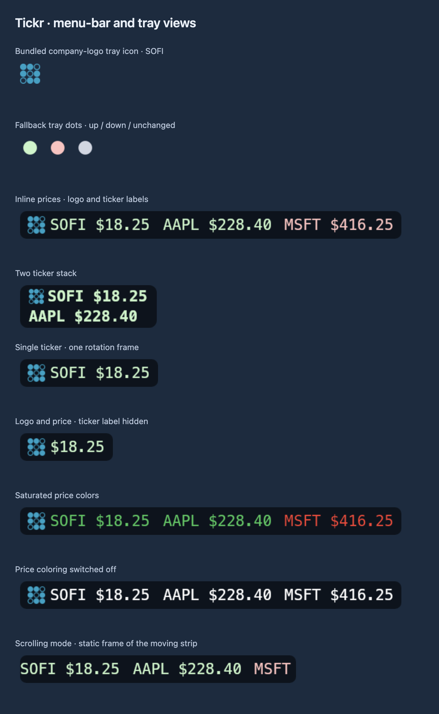
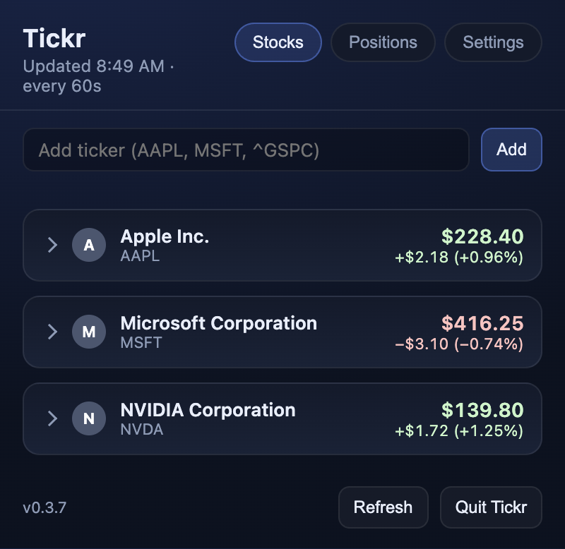
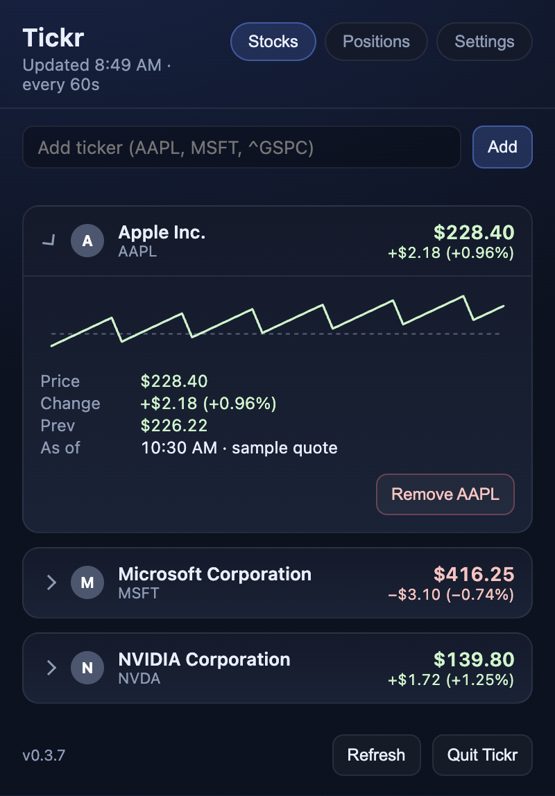
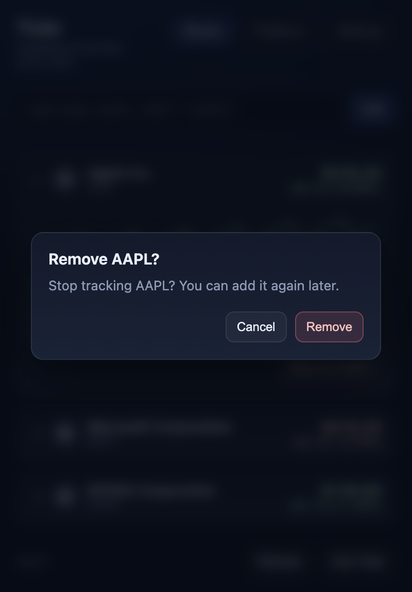
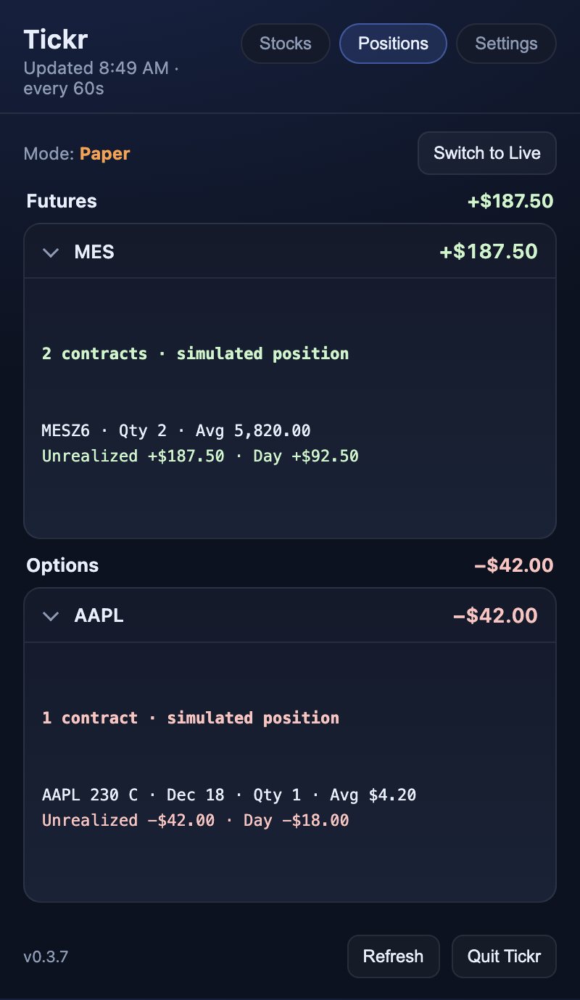
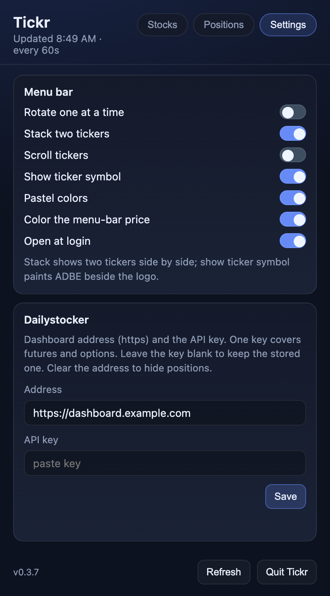
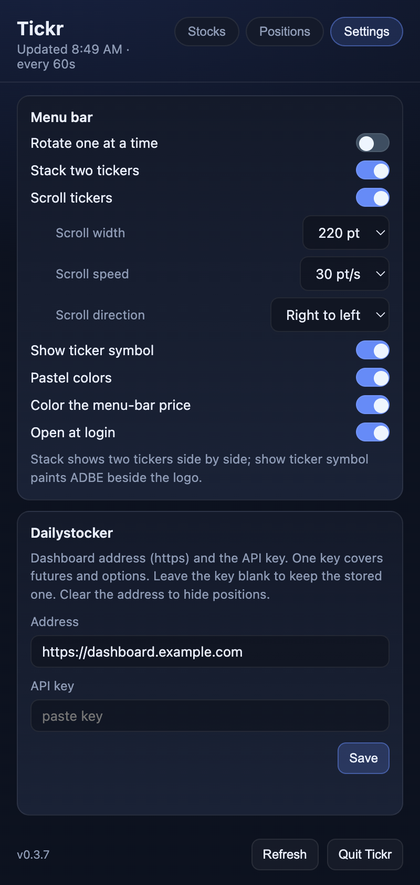
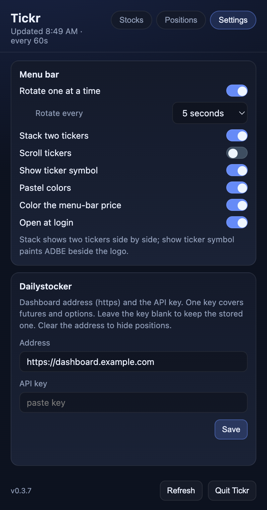

# Tickr

Tickr is a stock ticker for the **macOS menu bar** and the **Windows system tray**. It shows a live price for each symbol on your watchlist, in green when the price is up for the day and red when it is down. Click the icon for a dark panel with the watchlist, a small intraday chart per symbol, and optional futures and options from a dashboard you configure.

Quotes come from Yahoo Finance’s public chart API. No Yahoo key is required.

Tickr is an Electron + TypeScript app at the repo root. The original Swift menu-bar app is still in [`menubar/`](menubar/) for reference; it is no longer the install path.


## Menu-bar previews

Company-logo and fallback icons, inline prices, stacked prices, rotation and scrolling frames, and color/symbol choices. Prices are fictional.

<a href="docs/screenshots/menu-bar.png"></a>

The labeled sheets enlarge the app’s actual rendered artwork 2× for detail. The neutral backdrops are presentation surfaces, not captures of a personal desktop.

[Full menu-bar gallery and regeneration instructions](docs/menu-bar.md)

## Screenshots

Screenshots of the current Electron interface on macOS, using fictional projects, accounts, jobs, and values. No personal data or live credentials are used.

<a href="docs/screenshots/stocks.png"></a>

The gallery includes detail views, settings, and available actions. Click an image for the full-resolution capture.

<details>
<summary>View dashboard screenshots</summary>

| Menu Bar | Stocks |
| --- | --- |
| <a href="docs/screenshots/menu-bar.png"></a><br>Actual menu-bar renderer with synthetic values, arranged on a presentation backdrop. | <a href="docs/screenshots/stocks.png"></a><br>Watchlist with example prices and positive and negative daily changes. |

| Stock Details | Remove Confirmation |
| --- | --- |
| <a href="docs/screenshots/stock-details.png"></a><br>Expanded stock with the session sparkline and quote details. | <a href="docs/screenshots/remove-confirmation.png"></a><br>Removing a stock asks for confirmation. |

| Positions | Settings |
| --- | --- |
| <a href="docs/screenshots/positions.png"></a><br>Paper futures and options, grouped by symbol. | <a href="docs/screenshots/settings.png"></a><br>Menu-bar display preferences and Dailystocker connection form. |

| Scroll Settings | Rotation Settings |
| --- | --- |
| <a href="docs/screenshots/scroll-settings.png"></a><br>Scrolling exposes width, speed, and direction settings. | <a href="docs/screenshots/rotation-settings.png"></a><br>Ticker rotation and its interval selector. |

</details>

The menu-bar sheet uses the app’s actual drawing code with sample values, arranged on a neutral backdrop. It is not a capture of a personal desktop.

[How these screenshots are made](docs/screenshots/README.md)

---

## Requirements

### Both platforms

- [Node.js](https://nodejs.org/) **20 or newer** (includes `npm`), to build from source
- Git, to clone

### macOS

- macOS **13** (Ventura) or later, Apple Silicon or Intel (the build targets the machine you run it on)

### Windows

- Windows **10** or **11**
- PowerShell 5+ (built in) to run the install script
- Permission to run a locally built, unsigned NSIS installer (SmartScreen may warn on first run)

---

## Install on macOS

```bash
git clone https://github.com/krisrmgua/Tickr.git
cd Tickr
./scripts/install.sh
```

`install.sh`:

1. Runs `npm install` and `npm run pack:mac` (electron-builder, output under `release/`)
2. Quits a running Tickr (Swift or Electron) and replaces `~/Applications/Tickr.app`
3. Ad-hoc signs the bundle and clears the quarantine flag
4. Links `~/bin/tickr` to the repo’s `tickr` control script
5. Launches Tickr

The first build downloads Electron (~100 MB) and can take a few minutes. Run `./scripts/install.sh` again to update. The bundle id is still `com.krsimmons.tickr`.

On the first launch of a packaged build, Tickr turns on **Open at login** (Settings tab). If you already have the Swift-era LaunchAgent from `tickr enable`, Tickr leaves login alone, because that agent now launches the Electron app at the same path.

### macOS control script

`tickr` at the repo root (linked to `~/bin/tickr` by the installer):

```bash
tickr status    # running, LaunchAgent, autostart
tickr start     # start the app if it is not running
tickr stop      # quit the running app
tickr enable    # start at login through a LaunchAgent
tickr disable   # stop starting at login (leaves the app running)
tickr install   # same as ./scripts/install.sh
```

Put `~/bin` on your PATH once if `tickr` is not found:

```bash
echo 'export PATH="$HOME/bin:$PATH"' >> ~/.zprofile
```

### Gatekeeper

This is a local build, not notarized. If macOS blocks it, use System Settings → Privacy & Security → allow Tickr, or right-click `Tickr.app` → Open.

---

## Install on Windows

In PowerShell:

```powershell
git clone https://github.com/krisrmgua/Tickr.git
cd Tickr
.\scripts\install.ps1
```

If PowerShell blocks scripts:

```powershell
Set-ExecutionPolicy -Scope CurrentUser RemoteSigned
.\scripts\install.ps1
```

`install.ps1` runs `npm install` and `npm run pack:win`, closes a running Tickr, and launches the NSIS setup `.exe` from `release\`. Pick an install folder in the wizard and finish.

Tickr appears in the **system tray** near the clock. Windows often hides new tray icons: click the **^** overflow arrow and drag Tickr onto the taskbar.

On first run of the setup `.exe`, SmartScreen may say “Windows protected your PC” because it is not signed with a purchased certificate. Choose **More info** → **Run anyway** if you built it yourself.

To update, `git pull` and run `.\scripts\install.ps1` again. To uninstall, use **Settings → Apps → Tickr → Uninstall**. Settings under `%APPDATA%\Tickr` are left in place.

---

## Tray

The tray polls Yahoo every 60 seconds. A failed refresh keeps the last good quote and shows the error in orange in the panel.

**macOS** shows the symbol’s logo as the tray image and the price as the title text next to it, for example `$14.15  AAPL $230.10`. When the first symbol has a logo, its ticker text is dropped, as in the Swift app. The title is green or red for the day (**Color the menu-bar price**, on by default). Hover for a tooltip with every symbol’s price and change.

**Windows** trays only draw an icon. Tickr shows the current symbol’s logo, or a green / red / grey dot when there is no logo. The tooltip lists every symbol with price and change, and the panel holds the full view.

The `SOFI` logo ships with the app. Other logos are downloaded once from Financial Modeling Prep’s public symbol images and cached in the app data folder. A missing logo falls back to a dot in the tray and a letter tile in the panel.

Right-click the tray icon for **Open Tickr**, **Refresh**, and **Quit Tickr**.

### Display modes

Set from the panel’s **Settings** tab:

| Mode | Default | macOS | Windows |
|---|---|---|---|
| **Rotate one at a time** | off | Title shows one symbol and cycles the watchlist | Tray logo / dot cycles; tooltip lists all |
| **Rotate every** | 5 s | 3, 5, 10, 15, 30, or 60 seconds | Same |
| **Stack two tickers** | off | Two tickers side by side; with rotate, pages through pairs | Hidden |
| **Scroll tickers** | off | Fixed-width marquee in the title. Width 100–280 pt, speed Crawl to Very fast, direction either way | Hidden |
| **Pastel colors** | on | Soft green / red in the panel and tray dot | Same |

Rotation starts once you have at least two symbols (three with stack). Scroll turns rotate and stack off; rotate or stack turns scroll off.

---

## Panel

Click the tray icon to open the dark panel. Click outside it, or press Escape, to hide it.

- **Stocks** lists each symbol with logo, name, price, and change. Click a row for a sparkline of the day’s 5-minute bars with a dashed previous-close line, plus Price, Change, Prev, and As of. **Remove** is in the expanded row. The last symbol cannot be removed.
- The add box at the top checks a ticker against Yahoo and appends it. Tickers are uppercased. Letters, digits, `.`, `-`, and `^` are kept.
- **Positions** appears once Dailystocker is configured (below).
- **Settings** holds the display modes, **Open at login**, and Dailystocker.
- **Refresh** fetches quotes and positions now. **Quit Tickr** exits the app.

---

## Futures and options (Dailystocker)

Tickr can show open futures and options from a dashboard that serves `GET /api/positions/summary.json`. Futures are grouped by root (MES, ES, and so on). Options are grouped by underlying. Each group shows open P&L. Click a group for quantity, average, unrealized P&L, and day P&L per contract.

In **Settings → Dailystocker**, enter the dashboard address and the API key. The address has to be `https`. The key is sent as the `X-Api-Key` header. Leave the key blank to keep the one already stored. Clear the address and save to hide positions.

Until both are set, the **Positions** tab stays hidden. A failed request shows an orange row and keeps the last good numbers. The dashboard’s own `stale` flag marks an old snapshot.

**Mode: Live** is the default. **Switch to Paper** changes the `mode` query. Live is green and Paper is orange. The same key covers both.

---

## What is stored

| Item | macOS | Windows |
|---|---|---|
| App data folder | `~/Library/Application Support/Tickr/` | `%APPDATA%\Tickr\` |
| Watchlist and display settings | `prefs.json` in that folder | Same |
| API key | `positions-api-key` in that folder, mode `600` | Same file, protected by your user profile’s ACL |
| Logo cache | `logos/` in that folder | Same |

`prefs.json` uses the Swift app’s key names: `trackedSymbols` (empty falls back to `SOFI`), `rotateOneAtATime`, `rotateIntervalSeconds`, `stackTwoTickers`, `scrollTickers`, `scrollWidthPoints`, `scrollSpeedPointsPerSecond`, `scrollDirection`, `pastelBarColors`, `dailystockerBaseURL`, `dailystockerMode`, plus `colorTrayTitle`.

On macOS, the first launch copies those settings from the Swift app’s UserDefaults domain (`com.krsimmons.tickr`). The Swift app kept its API key and logo cache in the same Application Support folder, so they carry over as is.

Tickr does not store a Yahoo password. On macOS it is an accessory app (`LSUIElement`), so it has no Dock icon.

---

## Develop

```bash
npm install
npm run dev
```

`npm run dev` compiles the Electron main process, starts the Vite UI on `http://127.0.0.1:5174`, and launches Electron with `TICKR_DEV=1` (the panel does not hide on blur).

| Script | Purpose |
|---|---|
| `npm run build` | Production UI + Electron compile |
| `npm run check` | Offline parse and logic checks (quotes, positions, prefs, tray text). No network. |
| `npm start` | Build, then run Electron against `dist/` |
| `npm run pack:mac` | macOS `.app` + zip under `release/` |
| `npm run pack:win` | Windows NSIS installer under `release/` |
| `npm run pack` | Both (needs a toolchain that can build both) |

## Layout

| Path | What |
|---|---|
| `electron/` | Main process: tray, panel window, polling, IPC, prefs and key storage |
| `electron/core/` | Pure logic with no Electron imports: Yahoo and Dailystocker parsing, prefs, tray text, view models |
| `src/ui/` | Panel HTML, CSS, and TypeScript |
| `scripts/` | `install.sh` (macOS) and `install.ps1` (Windows) |
| `tickr` | macOS status, install, start, stop, and login control |
| `menubar/` | The original Swift Package Manager app, kept for reference |

## Version

The shipping version is `package.json` → `version` (currently **0.3.0**). The panel footer shows it as `v0.3.0`. Bump that field before each release you push and package; Electron Builder embeds it so `app.getVersion()` matches.

## License

[MIT](LICENSE). Copyright 2026 Kristopher Simmons.
