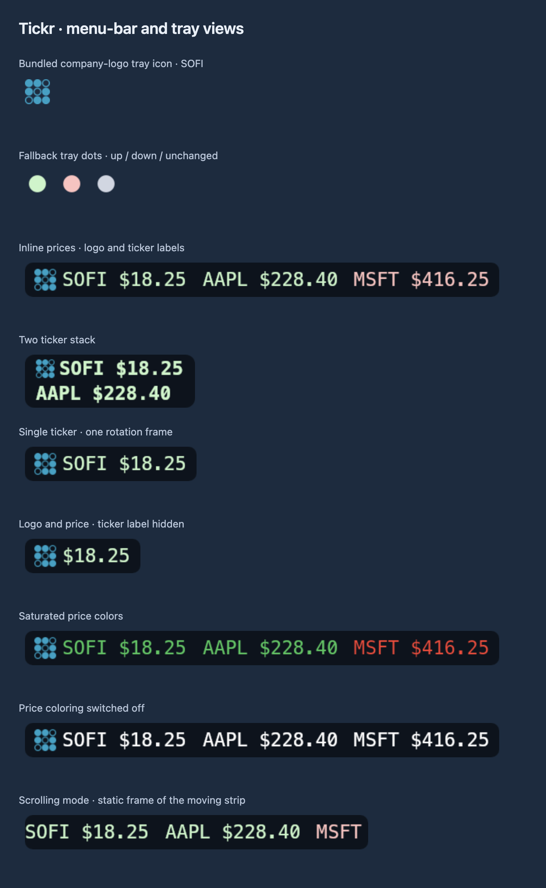

# Menu-bar gallery

Every icon/capsule is produced by the app’s real drawing functions. Sample values are fictional. Labeled sheets enlarge rendered PNGs 2×; the combined TokenPulse strip retains its original Retina pixels. No account data, credentials, private repository data, job state, or live prices are read. The entry point never starts the production backend and blocks network requests.

## Regenerate only menu-bar previews

```bash
npm install
npm run build:electron
npx electron scripts/menu-screenshots.cjs
```

Run on macOS for the same renderer/font environment. `scripts/screenshots/menu.cjs` defines examples and calls production drawing functions; `menu-board.cjs` supplies presentation labels and backdrops. `docs/screenshots/menu-manifest.json` records the generated image dimensions. The regular full screenshot command also includes these menu previews.

## Menu Bar

Actual Tickr company-logo and fallback icons, inline and stacked prices, rotation and scrolling frames, and color/symbol options. All prices are fictional.


