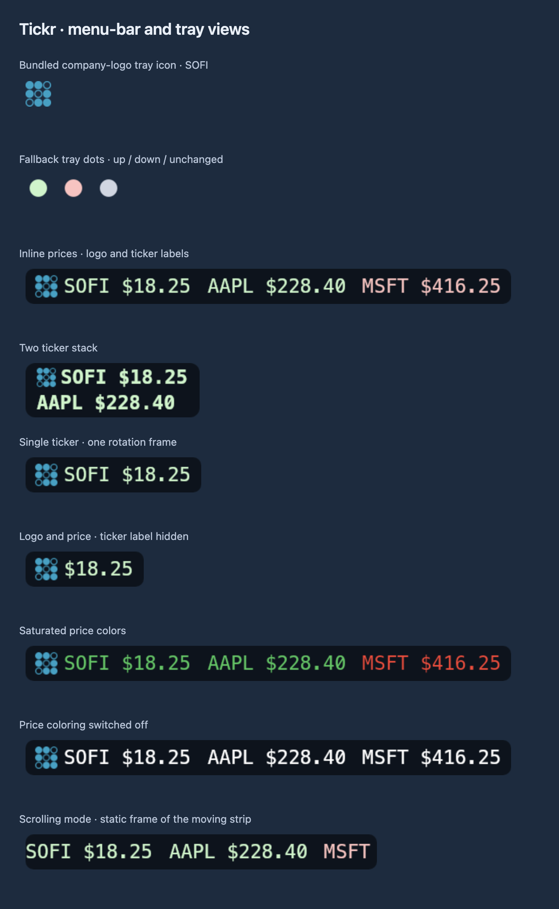
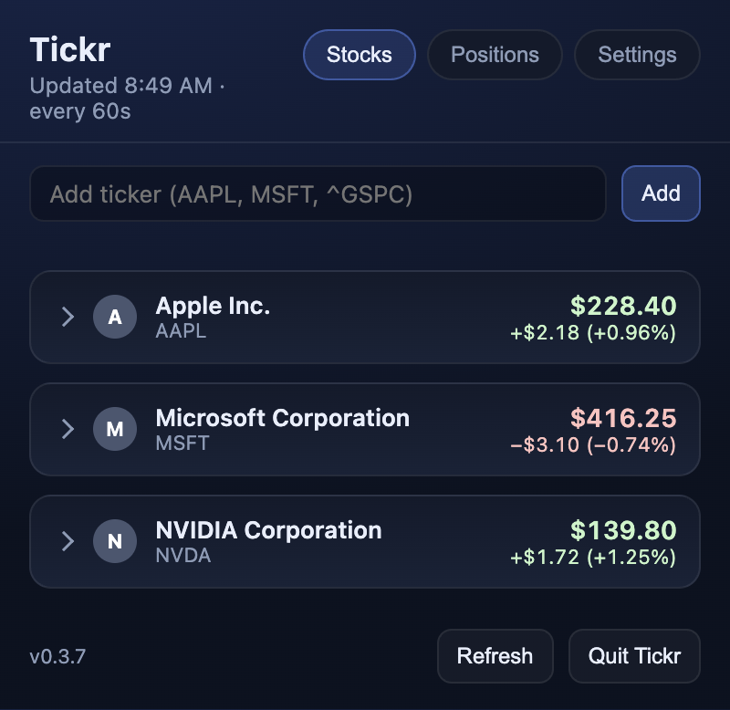
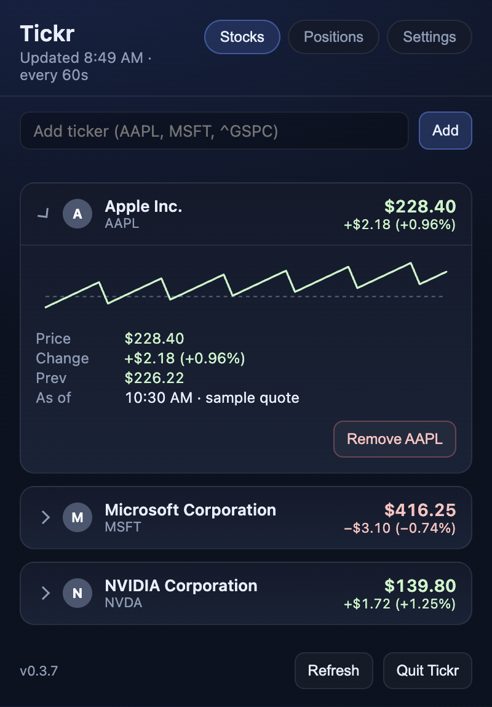
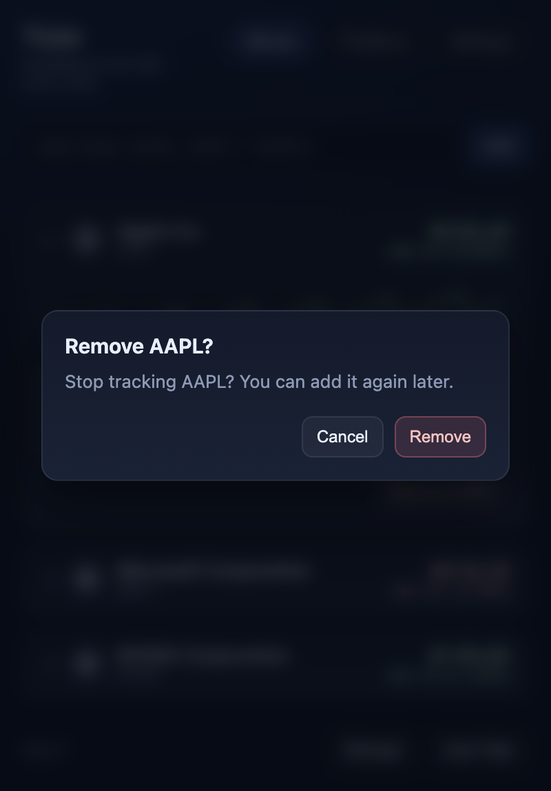
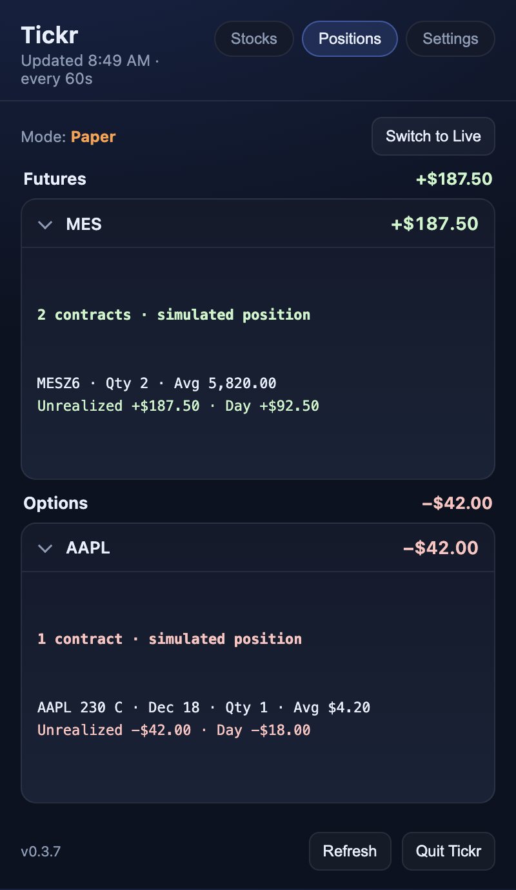
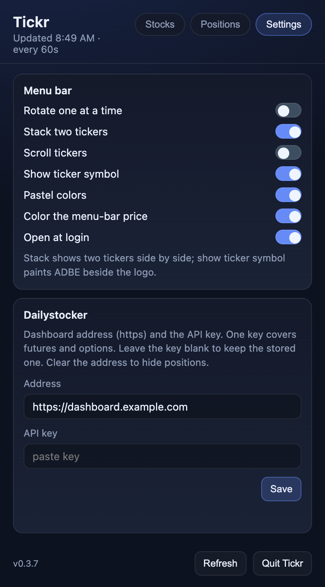
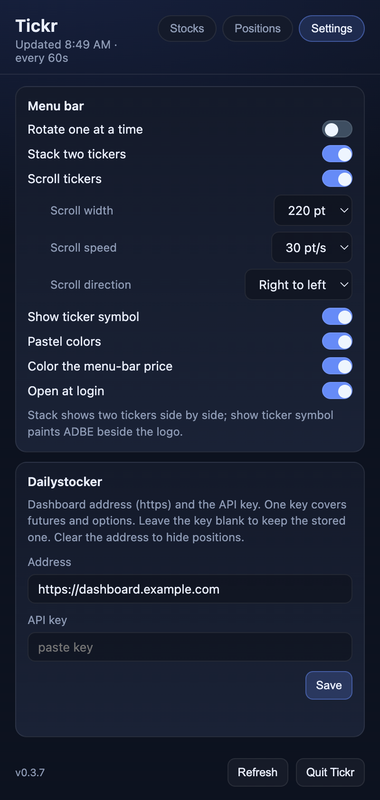
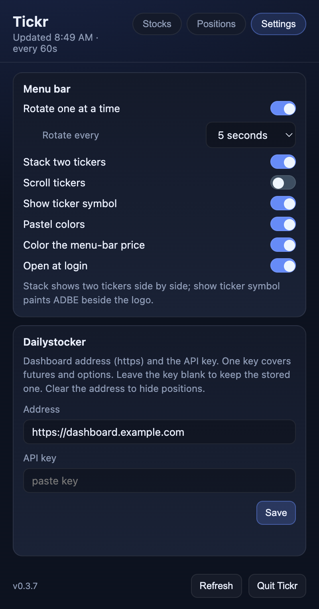

# Screenshot gallery

Screenshots of the current Electron interface on macOS, using fictional projects, accounts, jobs, and values. No personal data or live credentials are used.

These are captures of `dist/index.html` built from the repository’s actual `src/ui` code. The layout, typography, colors, controls, and dialogs come from the app. A separate Electron entry point supplies synthetic state through a mock preload bridge; it never starts the production main process. Network requests are blocked, and application data goes to a temporary directory. Actions such as run, delete, merge, refresh, and save are inert.

No installed app, sign-in, API key, real repository scan, market-data request, or scheduled command is needed. Example stock prices, allowance percentages, balances, and positions are illustrative. There are no AI-generated interface images.

Captured from version **0.3.7**, source revision `7d6026d`.


## Menu-bar icons and views

[Open the complete menu-bar gallery](../menu-bar.md), including the actual icon artwork and supported display states.


## Recreate

From the repository root, after installing dependencies:

```bash
npm install
npm run build:ui
npm run build:electron
npx electron scripts/screenshots.cjs
```

Run this on macOS with a graphical session for the same fonts and platform controls. The capture window is hidden and uses a 2× device scale. Other platforms can render different fonts and native controls. Dates and relative times are sample data and may differ when recaptured.

`scripts/screenshots/fixture.cjs` defines every sample and the click sequence. `preload.cjs` provides the isolated mock bridge. `manifest.json` lists each image, its purpose, and its pixel size. Do not replace the fixture bridge with the production preload when capturing public documentation.

## Menu-bar sheet

`menu.cjs` calls the production menu-bar renderer with synthetic values and arranges the rendered PNGs on a labeled background. This sheet demonstrates the actual styles without exposing the rest of a desktop.

## Views

### Menu Bar

Actual menu-bar renderer with synthetic values, arranged on a presentation backdrop.



### Stocks

Watchlist with example prices and positive and negative daily changes.



### Stock Details

Expanded stock with the session sparkline and quote details.



### Remove Confirmation

Removing a stock asks for confirmation.



### Positions

Paper futures and options, grouped by symbol.



### Settings

Menu-bar display preferences and Dailystocker connection form.



### Scroll Settings

Scrolling exposes width, speed, and direction settings.



### Rotation Settings

Ticker rotation and its interval selector.


